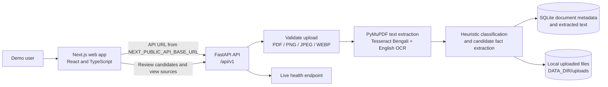

# CareBridge AI

CareBridge AI is a Bangla-first personal health record demonstration that helps people organize medical documents and review information extracted from them. It brings records such as prescriptions, laboratory reports, and discharge summaries into a single workspace with a chronological view and source-linked document context.

> **Demonstration only.** CareBridge AI is not a medical device, a production electronic health record (EHR), or a source of diagnosis or treatment advice. Use synthetic or de-identified records only.

## Live demo

- **Web app:** [carebridge-web-p5qg.onrender.com](https://carebridge-web-p5qg.onrender.com/)
- **Backend API:** [carebridge-api-w2h3.onrender.com](https://carebridge-api-w2h3.onrender.com/)
- **API liveness:** [GET /api/v1/health/live](https://carebridge-api-w2h3.onrender.com/api/v1/health/live)
- **Interactive API documentation:** [Swagger UI](https://carebridge-api-w2h3.onrender.com/docs)

The public demo uses free Render services. They may take time to wake after inactivity, and their storage is temporary. Do not upload real patient information.

## Contents

- [Project overview](#project-overview)
- [Vision and objectives](#vision-and-objectives)
- [Core features](#core-features)
- [User workflow](#user-workflow)
- [Screens and modules](#screens-and-modules)
- [System architecture](#system-architecture)
- [Technology stack](#technology-stack)
- [Repository structure](#repository-structure)
- [Backend API](#backend-api)
- [Local development](#local-development)
- [Environment variables](#environment-variables)
- [Tests and quality checks](#tests-and-quality-checks)
- [Deployment on Render](#deployment-on-render)
- [Data handling and security](#data-handling-and-security)
- [Current limitations](#current-limitations)
- [Roadmap](#roadmap)
- [Demo data disclaimer](#demo-data-disclaimer)
- [Contributing](#contributing)
- [License](#license)

## Project overview

Personal medical information is often fragmented across paper prescriptions, laboratory reports, discharge summaries, scans, and files kept by different providers or family members. That makes it difficult to find a document, follow a health history over time, or understand where a piece of information came from.

CareBridge AI explores a unified, patient-facing health-record experience. A user can upload supported documents, review extracted text and candidate laboratory facts, browse records by date, and trace displayed information back to its source document. The current implementation is a competition-stage prototype with a local document-processing API and a web interface. It is not a certified medical device or a production-ready EHR system.

## Vision and objectives

The project aims to make personal health history easier to collect and understand, including for Bangla-speaking users. Its current objectives are to:

- Provide a simple workspace for uploaded health documents.
- Make extracted information reviewable against source text and the original file kept by the API.
- Present records chronologically and surface a small set of candidate laboratory values.
- Explore a bilingual English and Bangla interface without presenting extracted candidates as clinical conclusions.

## Core features

Implemented in the current web and API code:

- English and Bangla interface toggle; the selection is saved in browser local storage.
- Patient-style overview with record counts, pending candidate reviews, recent uploads, and API status.
- PDF, PNG, JPEG, and WEBP uploads with a 10 MiB size limit and file-type signature checks.
- PDF text-layer extraction with PyMuPDF and Bengali/English OCR for scans and images through Tesseract.
- Heuristic document categories: prescription, laboratory report, discharge summary, or general medical document.
- Search by filename and category filtering in the document list.
- Extracted text, extraction method, page references, and excerpts that link candidate facts to their source context.
- Candidate extraction for a small set of English laboratory labels (hemoglobin, glucose, creatinine, and WBC); users can confirm or reject candidates.
- Chronological timeline using an identified document date when available, otherwise the upload date/order context.
- Lab results table with source links and review status. The interface does not calculate clinical ranges or provide interpretation.
- Record-based summary view assembled from extracted document facts and source context. Despite the screen label, this is not a generative AI summary.
- Settings/profile-style screens for the demo identity and interface preferences.
- Care-team sharing screen labeled **DEMO / NOT CONNECTED**. It does not share records.

## User workflow

1. Open the overview or Medical records screen and upload a supported PDF or image.
2. The API validates and extracts readable text, classifies the document heuristically, and stores the file and its document metadata.
3. Review the extracted text and candidate lab facts alongside their page and source excerpts.
4. Confirm or reject each candidate against the original document.
5. Browse uploaded records in the timeline, lab results view, or source-linked summary screen.

Extraction can be incomplete or wrong. Review the original document; the interface is not a substitute for professional medical interpretation.

## Screens and modules

| Screen | Current behavior |
| --- | --- |
| Overview | Record totals, pending review count, recent documents, upload action, and backend status. |
| Medical records | Upload, search, filter by detected category, and inspect extracted source text and candidate facts. |
| Health timeline | Browse records chronologically and open their source context. |
| Lab insights | View extracted candidate values, dates, sources, and review states. No reference ranges or trend analysis are produced. |
| AI summary | Shows a template-based summary from extracted records; it does not call an AI model. |
| Care team | **DEMO / NOT CONNECTED**; authentication, permissions, and sharing are not implemented. |
| Settings | Demo profile and browser-local language preference. This is not an account or identity system. |

## System architecture

The frontend is a Next.js application. It uses `NEXT_PUBLIC_API_BASE_URL` as the API base URL. The overview checks the API liveness endpoint; browser-side document actions call the document endpoints. The FastAPI service processes uploads and stores the demo's document records in SQLite and file bytes in a local uploads directory under `DATA_DIR`.



The current document workflow uses SQLite directly. SQLAlchemy and an optional `DATABASE_URL` are present for a separate database connectivity readiness check, but document operations do not use PostgreSQL. On the deployed free service, `DATA_DIR` points to temporary instance storage.

## Technology stack

Versions below reflect the manifests in this repository; Python package version ranges are declared in `apps/api/pyproject.toml` and an API lock file is also provided.

| Area | Technologies |
| --- | --- |
| Web | Next.js 15, React 19, TypeScript 5, Tailwind CSS 3 |
| API | Python 3.12, FastAPI, Uvicorn, Pydantic Settings |
| Document processing | PyMuPDF, Pillow, pytesseract, Tesseract OCR with Bengali and English language data |
| Document persistence | Python `sqlite3` and local filesystem under `DATA_DIR` |
| Database connectivity support | SQLAlchemy and psycopg for the optional PostgreSQL readiness check |
| API tests | pytest and FastAPI `TestClient` / HTTPX |
| Frontend checks | ESLint and TypeScript compiler (`tsc`) |
| Deployment | Render web services; API Blueprint configuration in `render.yaml`; API container in `apps/api/Dockerfile` |

## Repository structure

```text
.
├── apps/
│   ├── api/
│   │   ├── app/api/v1/       # Health and document routes
│   │   ├── app/core/         # Settings, errors, and logging
│   │   ├── app/db/           # Optional SQLAlchemy connectivity helpers
│   │   ├── tests/            # API tests
│   │   ├── Dockerfile
│   │   ├── pyproject.toml
│   │   ├── .env.example
│   │   └── requirements.lock
│   └── web/
│       ├── app/              # Next.js routes and styles
│       ├── components/       # Dashboard and navigation UI
│       ├── lib/              # API and document clients
│       ├── package.json
│       ├── .env.example
│       └── production.env.example
├── data/                     # Original Streamlit prototype data location
├── docs/
│   ├── phase-2/
│   │   ├── database-security-design.md
│   │   └── identity-provider-evaluation.md
│   └── README.md
├── infra/
│   └── README.md
├── render.yaml               # Render Blueprint for the API service
├── app.py                    # Original Streamlit prototype entry point
├── README.md
└── LICENSE
```

The legacy Streamlit prototype and its data locations are separate from the Next.js/FastAPI demo workflow.

## Backend API

The deployed API base is `https://carebridge-api-w2h3.onrender.com/api/v1`. Interactive documentation is available at [Swagger UI](https://carebridge-api-w2h3.onrender.com/docs). Routes implemented in `apps/api/app/api/v1/` include:

| Method and path | Behavior |
| --- | --- |
| `GET /health/live` | Process liveness check; returns `{"status":"ok"}` when the app responds. |
| `GET /health/ready` | Checks optional `DATABASE_URL` connectivity and returns readiness; responds with 503 when no database is configured or it cannot connect. It is not the SQLite document-store health check. |
| `POST /documents/upload` | Multipart form field `file`; accepts PDF, PNG, JPG/JPEG, or WEBP up to the configured 10 MiB limit. Returns the created document including extracted source text and candidate facts. |
| `GET /documents` | Lists stored documents and candidate facts, ordered by document date and upload time. List items omit full source text. |
| `GET /documents/{document_id}` | Returns a document, including extracted source text; returns 404 when absent. |
| `PATCH /documents/{document_id}/facts/{fact_id}` | JSON body `{"status":"confirmed"}` or `{"status":"rejected"}` updates a candidate's review state. Other status values are rejected. |

The API has no authentication or patient-level authorization. Anyone who can reach this demo API can access or modify its shared demo records. Use synthetic data only.

## Local development

### Prerequisites

- Git.
- Python 3.12 (required by `apps/api/pyproject.toml`).
- Node.js and npm compatible with the Next.js 15 project.
- For OCR of images and scanned PDFs: Tesseract with Bengali (`ben`) and English (`eng`) language data installed and available on `PATH`. Text-based PDFs use their embedded text layer and do not require OCR.

### Start the API (PowerShell)

From the repository root:

```powershell
py -3.12 -m venv apps/api/.venv
.\apps\api\.venv\Scripts\Activate.ps1
python -m pip install --upgrade pip
python -m pip install -e ".\apps\api[dev]"
Copy-Item apps/api/.env.example apps/api/.env
Set-Location apps/api
python -m uvicorn app.main:app --reload --port 8000
```

The API creates its SQLite database and `uploads` folder under the configured `DATA_DIR` (by default `.carebridge-mvp` at the repository root). No migration is required for this document workflow.

### Start the web app (second PowerShell terminal)

From the repository root:

```powershell
Set-Location apps/web
npm ci
Copy-Item .env.example .env.local
npm run dev
```

Open [http://localhost:3000](http://localhost:3000). The API is available at [http://localhost:8000](http://localhost:8000), its liveness endpoint at [http://localhost:8000/api/v1/health/live](http://localhost:8000/api/v1/health/live), and the docs at [http://localhost:8000/docs](http://localhost:8000/docs).

If PowerShell blocks virtual-environment activation, allow it for the current terminal session with `Set-ExecutionPolicy -Scope Process -ExecutionPolicy Bypass`, then activate again.

## Environment variables

Copy the example files for local use. They contain no credentials; keep real environment files out of version control.

### Web: `apps/web/.env.example`

| Variable | Purpose |
| --- | --- |
| `NEXT_PUBLIC_API_BASE_URL` | API base URL, including `/api/v1`. Local default: `http://localhost:8000/api/v1`. Production: `https://carebridge-api-w2h3.onrender.com/api/v1`. |

Because this variable uses the `NEXT_PUBLIC_` prefix, Next.js makes it available to browser code and it must be set for the web build/deployment. Change it and rebuild/redeploy when the API URL changes. `apps/web/production.env.example` shows the production format.

### API: `apps/api/.env.example`

| Variable | Purpose |
| --- | --- |
| `APP_ENV` | Environment label used by the service. |
| `LOG_LEVEL` | Application log level. |
| `DATABASE_URL` | Optional SQLAlchemy PostgreSQL connection used by `/health/ready`; document storage currently remains SQLite. |
| `CORS_ORIGINS` | Comma-separated exact browser origins allowed by the API. For the deployed web app, include `https://carebridge-web-p5qg.onrender.com`. |
| `CORS_ORIGIN_REGEX` | Optional regex for allowed origins; unset by default. |
| `DATA_DIR` | Directory for `documents.sqlite3` and uploaded files. |
| `MAX_UPLOAD_BYTES` | Upload size ceiling in bytes; the example is 10 MiB (`10485760`). |

## Tests and quality checks

Run the API tests from `apps/api` after installing the development extra:

```powershell
Set-Location apps/api
python -m pytest
```

Run the web checks from `apps/web` after `npm ci`:

```powershell
npm run lint
npm run typecheck
npm run build
```

The API tests cover liveness/readiness behavior and document upload, extraction, listing, retrieval, file validation, and OCR dependency error handling. These checks do not establish clinical accuracy, security, or production readiness.

## Deployment on Render

The public demonstration is hosted on Render. The repository's [`render.yaml`](render.yaml) defines the **API service** (`carebridge-api`) as a free Docker web service. It builds from `apps/api/Dockerfile`, installs Tesseract with Bengali and English language data, and uses `/tmp/carebridge-data` for the demo document store. The web service is configured in Render with the following settings:

| Service | Runtime and settings |
| --- | --- |
| `carebridge-web` | Node; root directory `apps/web`; build command `npm install && npm run build`; start command `npm start`; branch `feature/full-stack-foundation`. |
| `carebridge-api` | Python/FastAPI in the `apps/api` Docker image, managed by the Render Blueprint in `render.yaml`; branch `feature/full-stack-foundation`. |

Set the web service environment variable at build time:

```text
NEXT_PUBLIC_API_BASE_URL=https://carebridge-api-w2h3.onrender.com/api/v1
```

Set the API service's `CORS_ORIGINS` to the exact web origin (no trailing slash):

```text
https://carebridge-web-p5qg.onrender.com
```

After changing a web build variable, redeploy the frontend. If the web origin changes, update the API's CORS allowlist as well. No Render settings or environment variables are changed by this repository documentation.

On the free tier, services can spin down after inactivity, so the first request may take time. Free service storage is ephemeral: uploaded documents and SQLite data can be lost after a restart, redeploy, or instance replacement. Treat the deployment as a demonstration only.

## Data handling and security

- Uploads are stored by the API on its local filesystem, with metadata and extracted text in a SQLite database under `DATA_DIR`.
- The API limits file size, checks supported extensions and file signatures, and limits PDFs to 100 pages. Image dimensions are also bounded in the OCR path.
- The API does not send documents to an external AI service. Text extraction and fact matching run in the API process using the configured document libraries and OCR engine.
- Uploaded documents and extracted text are sensitive personal information even when the service is a demonstration. Use synthetic or de-identified samples only; do not upload real patient records to the public demo.
- Authentication, authorization, accounts, patient-level isolation, and connected care-team sharing are not implemented. Demo records are shared within the single service instance.
- Free Render storage is ephemeral and is not an encrypted, durable document store. The application does not provide production retention, backup, or deletion workflows.
- No HIPAA, GDPR, Bangladesh legal compliance, security certification, or clinical validation is claimed.

## Current limitations

- The extraction and classification logic is heuristic, narrow, and not clinically validated.
- Candidate laboratory extraction covers a few English labels only. It may miss values or misread text and units; every candidate needs comparison with the source document.
- OCR quality depends on scan quality and Tesseract language data. OCR can fail or return incomplete text.
- Date recognition supports a limited numeric format. Missing dates are shown as unknown or ordered using upload information.
- The “AI summary” screen is a template-based presentation of extracted record facts, not an AI-generated clinical summary.
- Lab trends, reference ranges, and clinician interpretation are not implemented.
- Care-team sharing, authentication, role-based authorization, patient isolation, and audit logging are not implemented.
- SQLite and uploaded files live on ephemeral local service storage in the public deployment.
- The app is a demonstration, not a production EHR or medical device.

## Roadmap

These are future directions, not current features:

- Secure authentication and verified patient identity.
- Role-based access control and patient-level data isolation.
- Persistent, encrypted document storage with backup and recovery.
- More reliable multilingual OCR and document extraction.
- Clinician-reviewed extracted facts and clearer provenance tooling.
- Broader laboratory coverage and carefully validated trend presentation.
- Secure, consent-based care-team sharing.
- Audit logs and data retention/deletion workflows.
- Production architecture, threat modeling, clinical validation, and relevant legal/compliance review.

## Demo data disclaimer

Use only synthetic or de-identified records in the public deployment. CareBridge AI does not diagnose, recommend treatment, or replace a qualified health professional. Extracted facts and summaries may be inaccurate or incomplete; always consult the original document and a clinician for medical decisions.

## Contributing

Contributions that improve usability, accessibility, documentation, or the safe handling of synthetic demo records are welcome. Before proposing changes, review the limitations above and avoid adding claims of clinical accuracy, security, or compliance without supporting validation. Open an issue to discuss a larger change, then submit a focused pull request with a clear description and relevant checks.

## License

This project is licensed under the [MIT License](LICENSE).
