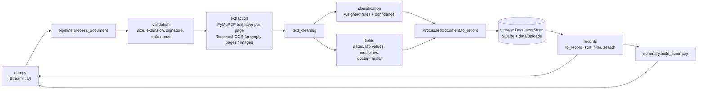

# Architecture

CareBridge AI is a single-process Streamlit app. All logic except rendering lives in the
`carebridge/` package, which has no Streamlit imports and is unit-tested on its own.

## Modules

| Module | Responsibility |
| --- | --- |
| `validation.py` | Extension allow-list, 10 MB limit, magic-byte signature check, UTF-8 check for `.txt`, filename sanitising, SHA-256. |
| `extraction.py` | Per-page PDF text; OCR only for pages with fewer than 25 alphanumeric characters; image OCR with EXIF rotation and pixel limit; detects missing Tesseract / language data; `CAREBRIDGE_OCR_LANG` override. |
| `text_cleaning.py` | Unicode NFC, control-character removal, whitespace normalisation (line breaks kept). |
| `classification.py` | `CATEGORY_RULES` (regex, weight) per type; scores → label + `high/medium/low` confidence; `Unknown` when nothing matches. |
| `fields.py` | Date candidates (ISO, D/M/Y, "12 Jan 2026", "Jan 12, 2026", Bengali digits), document-date choice, lab results (test, value, unit, reference range, page, source line), medicine lines (form, name, strength, frequency, duration as written), doctor, facility, patient name. |
| `pipeline.py` | Wires the stages; field validation (future dates, conflicting values, patient-name mismatch) produces warnings without changing data. |
| `storage.py` | `DocumentStore`: connection handling with rollback, additive schema migration with backup, duplicate lookup, save (file first, removed if insert fails), type confirmation, delete (row + file), delete-all for a profile. |
| `records.py` | Converts rows (old and new schema) to `DocumentRecord`; timeline sort; type filter and text search. |
| `summary.py` | Six-section extractive summary with `[D#, p.#]` references. |
| `demo.py` | Synthetic demo documents, loaded through the normal pipeline. |

## Data model

One table, `documents` (schema version 2, tracked with `PRAGMA user_version`).

| Column | Notes |
| --- | --- |
| `id`, `patient_name`, `filename`, `doc_type`, `doc_date`, `extracted_text`, `extracted_json`, `created_at`, `sha256` | Original columns, unchanged. `doc_date` is `NULL` when unknown for new rows; the legacy `"Date not identified"` string is read as unknown. `extracted_json` holds lab results (old rows keep their old shape). |
| `media_type`, `size_bytes`, `storage_name` | `storage_name` is `<id><ext>`; legacy rows (NULL) use the bare id, as before. |
| `extraction_method`, `classification_confidence`, `type_confirmed`, `date_status`, `status` | Processing metadata. `type_confirmed=1` after the user picks a type. |
| `pages_json`, `details_json`, `warnings_json` | Per-page text, non-lab extracted fields, user-facing warnings. |

Indexes: `sha256`, `patient_name`.

### Migration

On start-up `DocumentStore` compares `user_version` with `SCHEMA_VERSION`. If the existing database
has rows, it is first copied to `data/carebridge.v<old>-backup-<timestamp>.db`. Then missing
columns are added with `ALTER TABLE ... ADD COLUMN`. No row or column is deleted or rewritten.

## Where data lives

* `data/uploads/` — original files. `data/carebridge.db` — metadata and extracted text.
* Override with `CAREBRIDGE_DATA_DIR`. Nothing is sent to an external service.
